# Xgent Hub

English | [中文](README.md)

Xgent Hub is a local control console for the coding agents installed on your computer: Codex, Claude Code, Antigravity, WorkBuddy (CodeBuddy), DeepSeek Harness, OpenClaw, Ark CLI, Ollama and any OpenAI-compatible API. You drive all of them from one web workspace (desktop app, browser or phone). The core is a task board with an approval queue and diff review, not a model dropdown with a chat box.

> The user interface is currently in Simplified Chinese. It runs on Windows 10/11, macOS and Linux, and on a NAS (fnOS, Synology, ...) via Docker. The desktop app (Electron) and the installer are Windows-only for now; on macOS / Linux use the browser.

## Screenshots

**Dashboard**: task status, what needs your attention, and which agents are ready, at a glance.

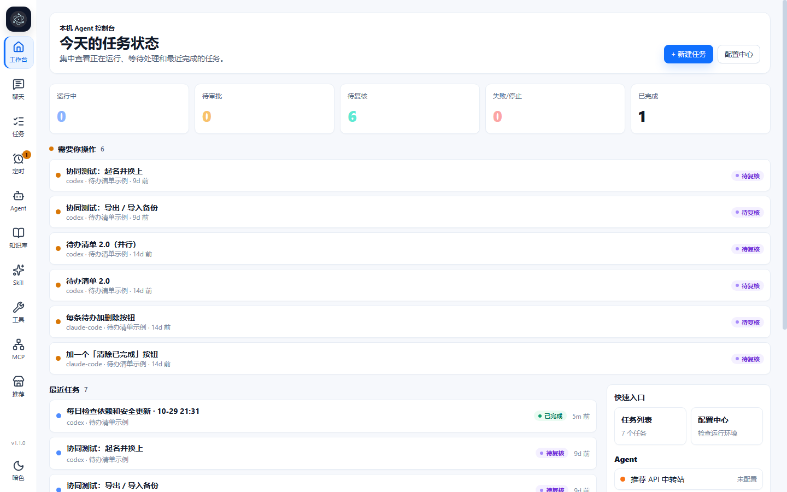

**Approvals**: Claude Code stops before editing a file and waits for you to allow it once, always allow, or deny.

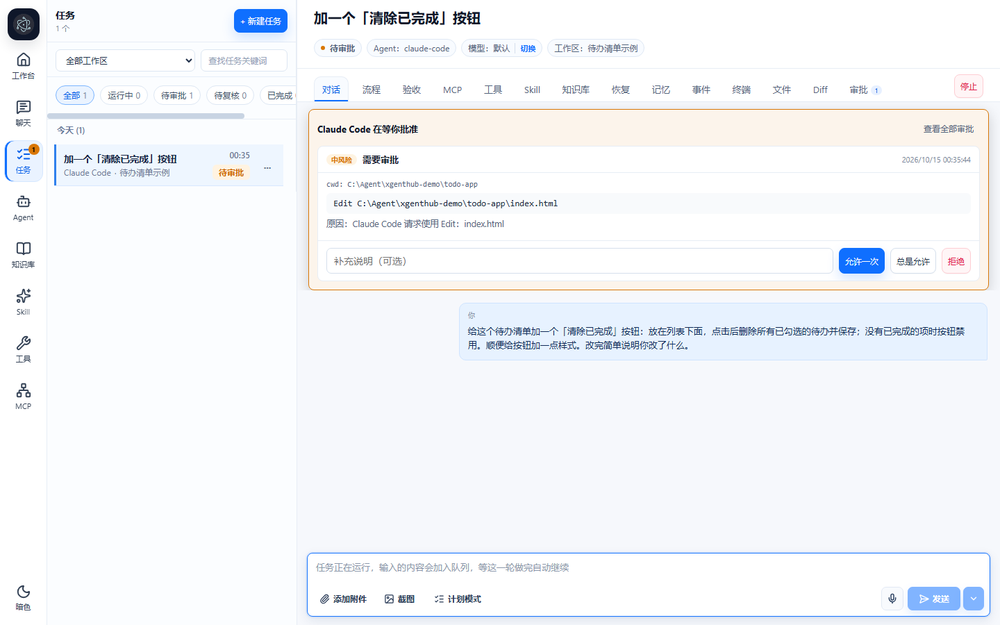

**Diff review**: every file the agent changed in this round, line by line, then accept or ask for changes.

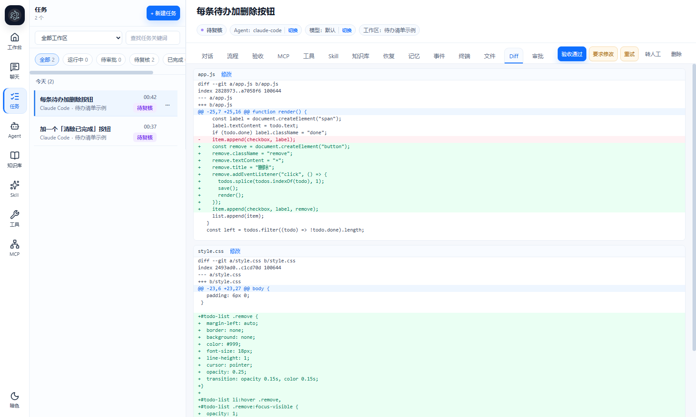

**Parallel agents**: one request split into subtasks handed to different agents (Codex, Claude Code, Antigravity…) that work at the same time; steps that depend on others wait for them, and everything comes back to the coordinator for a summary. The flow tab's "Structure" view draws it as a node graph you can drag and zoom; animated dashed edges are runs in progress.

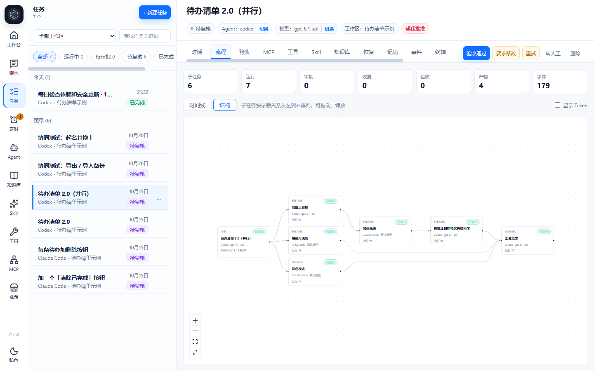

**Timeline**: the other view of the flow tab, one column per subtask, showing top to bottom what each agent did and when: received the task, ran commands, changed files, waited for approval, finished. Tick "Show tokens" to see how many tokens each step used.

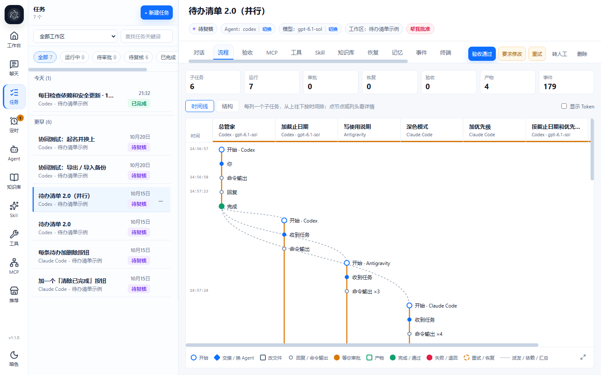

**Summary**: every subtask's reply is labelled with its subtask and agent; at the end the coordinator checks the whole workspace and hands you the result.

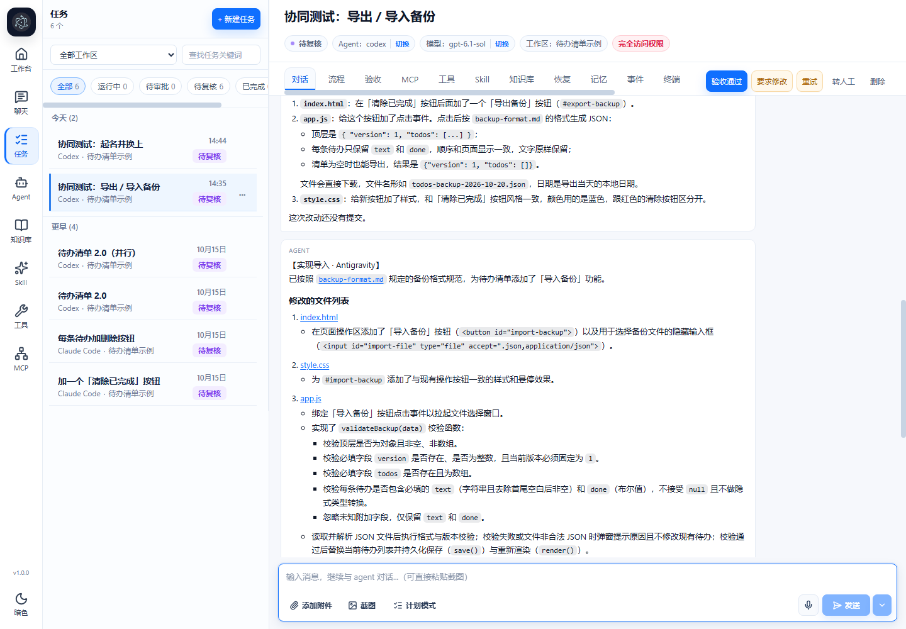

**Chat**: lightweight conversations with any agent and model, no workspace needed.

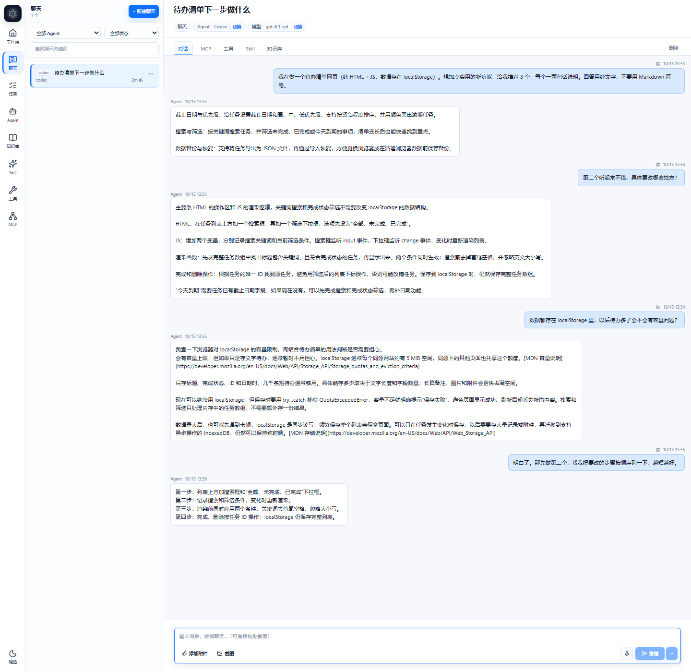

**Scheduled tasks**: agents do work on a schedule, e.g. check dependencies every weekday morning, write a weekly report on Fridays, or come back to a task every few hours to follow up. Unread results show as a number on the scheduled-tasks item in the left nav.

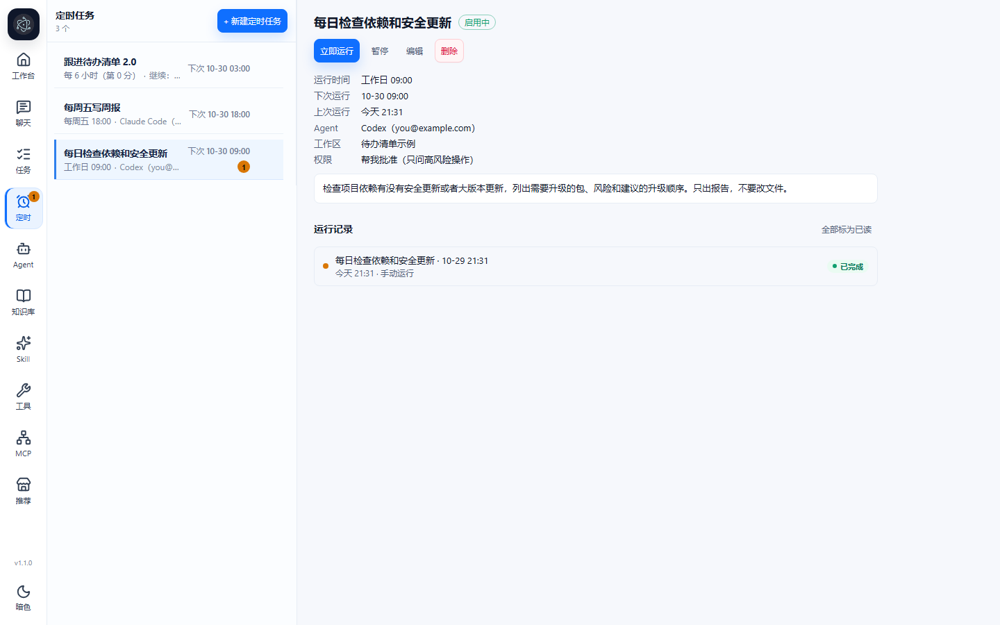

**MCP servers**: "Test connection" performs a real MCP handshake and lists the tools the server offers; MCP configs from elsewhere can be imported by pasting their JSON.

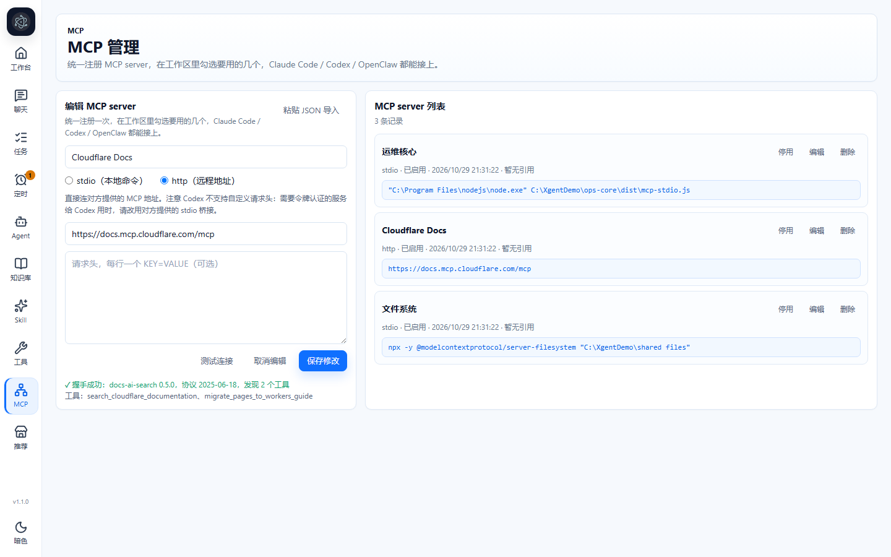

## Features

- **Tasks**: give an agent a job in a workspace folder and follow its messages, terminal output, file changes and diffs live. Stop it, continue the conversation, or hand the task over to another agent and model mid-way.
- **Approval queue**: risky actions (installing packages, running commands, `git push`, touching secrets) wait for your approval. Claude Code's own per-tool permission prompts appear in the same queue. A pop-up, sound, tab title and badge tell you when something is waiting.
- **Three permission levels per task**: ask for approval, approve for me (only high-risk actions ask), or full access.
- **Undo**: every agent turn is snapshotted, so you can roll a workspace back to before a turn.
- **AI task splitting with parallel execution**: when creating the task, tick which agents and roles it may use; the first request you send is split into subtasks, assigned and started automatically. Independent subtasks run at the same time, dependent ones wait, and the coordinator summarizes the results at the end. Not happy with one step? Redo just that step, and the steps that depend on it and the summary rerun automatically. The flow tab has a "Structure" node graph and a "Timeline" view, and can show tokens used per step. `AGENTHUB_MAX_PARALLEL_SUBTASKS` in `.env` limits how many run at once (unlimited by default).
- **Scheduled tasks**: the scheduled-tasks item in the left nav works like Codex automations, in two kinds: create a new task on schedule (with the agent or role, workspace, model and permission you chose), or send a message into an existing task so it carries on. Schedules can be every few hours, daily, weekdays or chosen days of the week. A run is skipped while the previous one is still going; nothing runs while Xgent is closed, and one catch-up run happens when it starts again.
- **Chat**: lightweight conversations with any agent, without a workspace.
- **Roles**: wrap an agent and model into a fixed persona ("designer", "copywriter") with its own instructions and knowledge.
- **Knowledge base, Skills, tools and MCP servers**: manage them once and attach them to workspaces, chats or roles. Skills can be installed straight from a GitHub link (for example Anthropic's `anthropics/skills`), with each skill's license shown. MCP "Test connection" does a real handshake and lists the tools; JSON in the `{"mcpServers": …}` format can be pasted in to import; HTTP servers that need a token can be connected through a stdio bridge (Codex has no custom request headers), and HTTP MCP servers that need an OAuth login no longer leave a Codex task stuck waiting for a browser sign-in.
- **Recommended catalog**: the "推荐" page lists curated skills, MCP servers and tools to install in one click, and flags new versions when the catalog changes. You can also subscribe to other catalogs (format: [catalog/README.md](catalog/README.md)).
- **Agent diagnostics**: each agent's page checks whether its CLI is installed and logged in, lists models and usage, and gives step-by-step install instructions.
- **Desktop app**: an Electron shell that starts the local service and logs in automatically.
- **Phone access**: use it from your phone over the LAN or Tailscale.
- **Data safety**: automatic database backups at startup and every 24 hours, with a restore script.

## Agents

Agents are the AIs that do the actual work. Xgent doesn't write code itself; it hands tasks to the agents you already use and manages them in one place:

- **Local CLI agents**: Codex, Claude Code, Antigravity, WorkBuddy (CodeBuddy), DeepSeek Harness, OpenClaw, Ark CLI. They read and write files in the workspace and run commands on your machine.
- **API agents**: the recommended API relay, Doubao, Hermes, a local Ollama, or any OpenAI-compatible endpoint — good for chat and tasks that don't touch files.
- **Custom agents**: plug in your own API or command-line tool.

The agent list on the left shows which account each agent is signed in with; "remaining usage" shows the quota right there. The "+" on the list opens the "Add agent" page: discover CLIs already installed on this machine, add a signed-in account for an agent, restore built-in agents you removed, or connect a custom API or command-line tool. Each agent's page has:

- **Account**: which account and plan it uses. Codex, Claude Code, WorkBuddy, DeepSeek Harness and Ark CLI can have several accounts, each with its own login, quota and sessions, and you pick one when creating a task just like picking an agent; a Claude Code account can also use an official API key or your own relay. Accounts can have a note, shown in brackets in the sidebar (the email is shown when the note is empty). The log-in button opens a login window (a Terminal window on macOS, a ready-to-run command on a NAS).
- **Diagnostics**: checks whether the CLI is installed and signed in, whether it is up to date, which models are available and how much quota is left, with copy-paste fix-up steps.
- **Settings**: CLI path, sandbox mode, default model and so on, applied immediately without editing `.env` by hand.

You can also wrap an agent as a **role** (e.g. "designer", "copywriter") with its own instructions, default model, knowledge, MCP servers, tools and skills; it then behaves like a new agent.

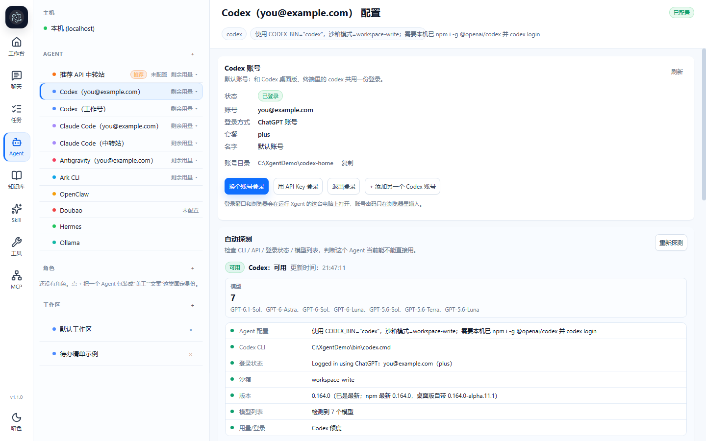

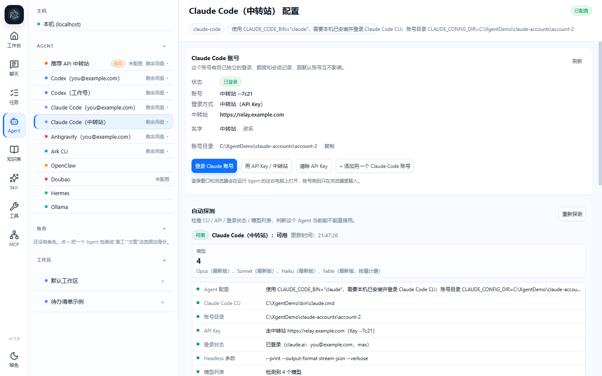

## Workspaces

A workspace is a project folder. Every task belongs to a workspace; the agent works inside that folder and its changes are tracked there:

- **Context**: project background, technical constraints and house rules (e.g. "no frameworks", "test before you finish"), sent to the agent with every turn so you don't repeat them in each task.
- **Extra access paths**: give the agent other folders too, such as design assets or a backup folder on a network drive.
- **Resources**: pick the knowledge groups, MCP servers, tools and skills this workspace uses; they apply to every task in it. They are managed once on the left and can be shared by several workspaces.
- **Snapshots and undo**: before each turn changes files, the workspace is snapshotted; the Files / Diff tab shows what that turn changed, and you can roll back to before it.
- **Allowed agents**: optionally limit which kinds of agents may work in this workspace.

In the Docker version, use the in-container path for a workspace, e.g. `/workspaces/my-project` (see the Docker install section).

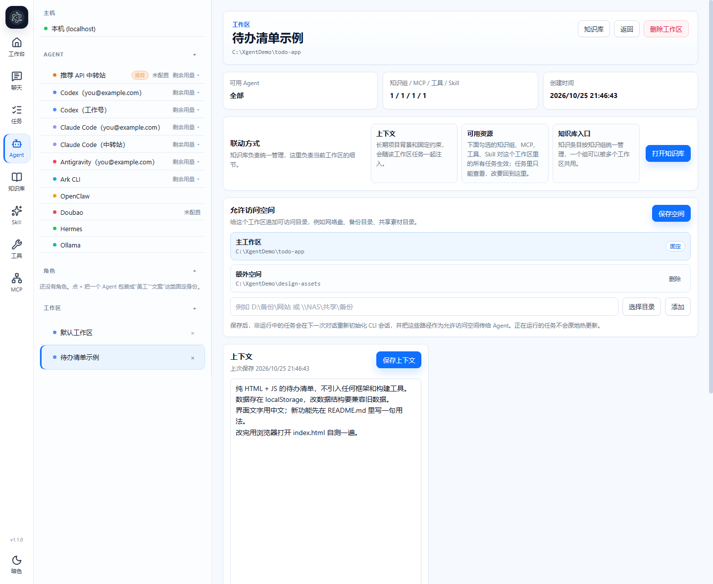

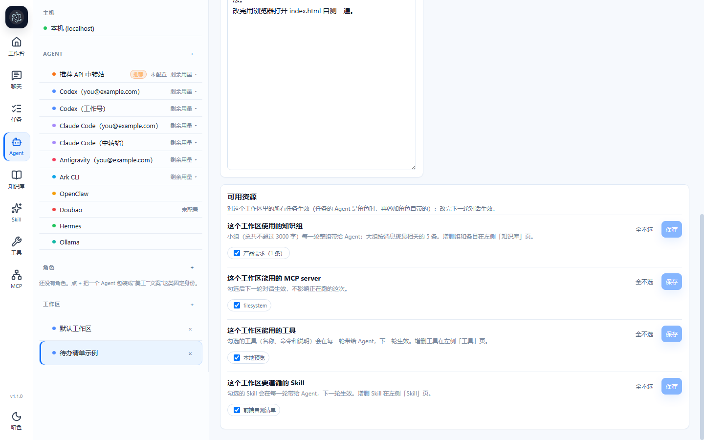

## Requirements

- Windows 10 / 11, macOS (Apple silicon or Intel) or Linux; for a NAS (fnOS, Synology, ...) use the Docker image
- [Node.js](https://nodejs.org/) 22.13 or newer (uses the built-in `node:sqlite` and TypeScript type stripping); not needed for Docker
- At least one agent: a CLI such as Codex or Claude Code, a local Ollama, or an API key for an OpenAI-compatible service

## Install (Windows)

```bash
git clone <this repository> XgentHub
cd XgentHub
install.bat
```

`install.bat` creates `.env` from `.env.example` with a randomly generated `ADMIN_TOKEN`, runs `npm install` and `npm run build`, then runs the self-check (`xgent.bat doctor`).

Optional switches:

```bash
install.bat -InstallShortcuts -InstallStartupTask -StartAfterInstall
```

Then start it:

- `start-app.bat` opens the desktop app. It starts the service if needed and logs in with the token from `.env` automatically.
- `xgent.bat start` starts only the background service. Open `http://127.0.0.1:4180` and sign in with the `ADMIN_TOKEN` value from `.env`.

On first launch the setup wizard (配置中心) walks you through the self-check, machine discovery (finds installed CLIs and writes their paths into `.env`), adding agents, startup options and a test task. A default workspace is created at `%USERPROFILE%\XgentHub-Workspace`.

## Install (macOS / Linux)

```bash
git clone <this repository> XgentHub
cd XgentHub
bash install.sh --service
```

`install.sh` creates `.env` with a random `ADMIN_TOKEN`, runs `npm ci` and `npm run build`. `--service` also sets up auto-start and starts it right away: launchd on macOS (runs after login, restarted if it crashes), a systemd user service on Linux. Use `--start` instead to just start it in the background once.

Open `http://127.0.0.1:4180` and sign in with the `ADMIN_TOKEN` value from `.env`. Day-to-day:

```bash
bash scripts/xgent.sh status       # status
bash scripts/xgent.sh restart      # restart (start / stop likewise)
bash scripts/xgent.sh logs         # follow the log
bash scripts/service.sh uninstall  # remove auto-start
```

- On macOS, if the Claude desktop app is installed, its bundled Claude Code is found automatically.
- On a Linux server, run `sudo loginctl enable-linger $USER` once so the service also runs without a login session.
- Online updates work as on Windows (click the version number at the bottom left); a failed update rolls back automatically.
- The desktop app (Electron), the self-check and config import/export are Windows-only for now; use the browser on macOS / Linux.

## Install (Docker: NAS / Linux server)

For a NAS such as fnOS or Synology, or a headless Linux server. The image ships Node.js, git, the Codex CLI and the Claude Code CLI.

```bash
git clone <this repository> XgentHub
cd XgentHub
docker compose up -d --build
docker compose logs xgent   # the first start prints the generated sign-in token here
```

Open `http://<NAS IP>:4180`. Everything lives in `xgent-data/` next to `docker-compose.yml`: `data/` holds the database and settings (token in `data/admin-token`), `home/` holds the Codex and Claude Code logins.

- **Project folders**: mount your NAS shares under `/workspaces` (edit `volumes` in `docker-compose.yml`) and use the in-container path, e.g. `/workspaces/my-project`, when adding a workspace.
- **Signing in to agents**: there is no screen for a login window. The "Log in" button on the agent page shows the command to run, e.g. `docker exec -it -u node xgenthub codex login --device-auth`; run it in the NAS terminal, open the link it prints on your phone or PC and enter the code. API keys work too.
- **Proxy**: set `HTTPS_PROXY` in `docker-compose.yml`.
- **Updating**: `git pull && docker compose up -d --build`; your data is kept. The in-app update button is not available in the Docker version.

## Supported agents

| Agent | How it connects | You need |
|---|---|---|
| Codex | `codex exec --json`, runs inside Codex's own OS sandbox | `npm install -g @openai/codex`, then `codex login` |
| Claude Code | `claude` headless mode (`--print --output-format stream-json`) | Claude Desktop (its bundled CLI is found automatically) or `irm https://claude.ai/install.ps1 \| iex` |
| Antigravity | `agy` headless mode | `irm https://antigravity.google/cli/install.ps1 \| iex`, then run `agy` once to sign in |
| WorkBuddy (CodeBuddy) | `codebuddy` headless mode (`-p --output-format stream-json`), using the quota that comes with the WorkBuddy account | `npm install -g @tencent-ai/codebuddy-code`, run `codebuddy` once and `/login` with the WorkBuddy account |
| DeepSeek Harness | `dsh` headless mode, using the DeepSeek account signed in to the desktop app | Install the DeepSeek Harness desktop app and sign in with a DeepSeek account |
| OpenClaw | `openclaw agent` through the local OpenClaw Gateway | `npm install -g openclaw`, gateway running |
| Ark CLI | `arkcli +chat` (Volcengine Ark / Doubao) | `npm install -g @volcengine/ark-cli@latest`, then `arkcli auth login` |
| Ollama | native Ollama API on `127.0.0.1:11434` | [Ollama](https://ollama.com/download) with at least one model pulled |
| Recommended API gateway | OpenAI-compatible API at `https://tokenezgo.com/v1` | an API key from [TokenEZGO](https://tokenezgo.com) |
| Doubao | Volcengine Ark OpenAI-compatible API | an Ark API key |
| Hermes | any local OpenAI-compatible server (vLLM, LM Studio, llama.cpp…) | the server running, default `http://127.0.0.1:8000` |
| Custom | your own OpenAI-compatible API or command-line tool | added from the Agent page |

Every agent's settings page has a diagnostics panel and an install guide with copyable commands. All settings live in `.env` (see `.env.example` for every option) and can also be edited from the UI.

## Permission levels

| Level | Behaviour |
|---|---|
| Ask for approval (default) | Anything Xgent Hub flags as risky waits in the approval queue. Claude Code asks before each tool use. |
| Approve for me | Only high-risk actions ask. Codex gets `--approve-for-me`; Claude Code gets `--permission-mode auto`. |
| Full access | Nothing is intercepted. Codex runs with `danger-full-access`. Only use it for prompts you fully trust. |

## Security

- The service listens on `127.0.0.1` by default. Binding to a LAN address requires `HOST` plus `ALLOW_LAN_BIND=true` in `.env`.
- Sign-in uses `ADMIN_TOKEN` from `.env` and issues an HttpOnly session cookie. If `ADMIN_TOKEN` is empty, the service runs without sign-in, so keep it set.
- Do not expose the port to the internet. For access away from home, use [Tailscale](https://tailscale.com/) (both devices on the same tailnet, then open `http://<tailscale-ip>:4180`) or a tunnel with its own authentication in front.
- Agents run with your user's permissions on your machine. Review what you approve, especially with full access.

## Daily operations

On Windows only three files in the root are meant to be run: `install.bat` (setup), `start-app.bat` (desktop app), and `xgent.bat` for everything else (same commands as `scripts/xgent.sh` on macOS / Linux):

| Command | What it does |
|---|---|
| `xgent.bat start` / `restart` / `stop` | Start, restart or stop the background service |
| `xgent.bat status` | Show service status, ports and log locations |
| `xgent.bat logs` | Show recent log lines (`logs -f` keeps following) |
| `xgent.bat doctor` | Self-check of Node, dependencies, configuration and installed CLIs |
| `xgent.bat autostart on` / `off` | Start in the background when you log in to Windows |
| `xgent.bat shortcuts install` / `remove` | Create or remove desktop and Start Menu shortcuts |
| `xgent.bat export-config` / `import-config` | Move your configuration to another computer (secrets are redacted unless you ask otherwise) |
| `scripts/restore-data.ps1` | List or restore automatic database backups from `backups/data` |

`xgent.bat help` lists every command; double-clicking `xgent.bat` shows the same help.

Logs are written to `logs/`, rotated monthly and kept for a year.

## Building an installer

No prebuilt installer is published. To make your own `.exe` for installing on other computers:

1. Get `install.bat` working on this machine first (see Install above).
2. Install [NSIS 3](https://nsis.sourceforge.io/Download). The default location `C:\Program Files (x86)\NSIS` is found automatically; otherwise run `npm run installer:nsis -- -MakensisPath <full path to makensis.exe>`.
3. In the project folder, run:

   ```bash
   npm run installer:nsis
   ```

   It builds the project and runs a release check (making sure no `.env`, database, logs or `server/data` files are included) before packaging.
4. The installer is written to `backups\XgentHub-setup-nsis-<date-time>.exe`.

Notes:

- The installer contains the program only, without `node_modules`. The target computer needs Node.js 22.13+ and internet access, because setup runs `npm install`.
- The installer is not code-signed, so Windows may show "Windows protected your PC". Choose "More info → Run anyway".
- It installs per user into `%LOCALAPPDATA%\Programs\Xgent Hub` without administrator rights. Uninstalling can keep your configuration and data.
- If NSIS is not installed, the script does not fail: it leaves the release zip and a ready-to-run compile command to use once NSIS is installed.

## Development

```bash
npm install
copy .env.example .env    # set ADMIN_TOKEN
npm run dev               # backend on :4180, Vite dev server on :5180
npm test                  # server tests (node --test)
npm run build             # type-check the server and build the web UI
```

Set `AGENTHUB_ENABLE_MOCK=1` in `.env` to show the Mock Agent, which simulates a full task (plan, file edits, diff, approvals) without calling any model. Tests enable it automatically.

Project layout:

```
server/   Fastify + TypeScript backend, SQLite storage, SSE events, agent adapters
web/      React + Vite frontend
desktop/  Electron desktop shell
scripts/  Service, install, update, backup and diagnostics scripts (Windows-only ones in scripts/windows/)
```

To add a new agent runtime, implement the `AgentAdapter` interface (`server/src/adapters/types.ts`) in a new file under `server/src/adapters/`, register it in `server/src/adapters/registry.ts`, and add any new settings to `server/src/config.ts` and `.env.example`. The task manager, routes and UI only depend on that interface.

## License

Xgent Hub is dual-licensed:

- **Open source: [GNU AGPL-3.0](LICENSE).** Anyone, including companies, may use, modify and distribute it free of charge. If you modify it and offer it to others over a network, or distribute a modified version, you must publish the complete source of your changes under the AGPL-3.0.
- **Commercial license.** To use or modify Xgent Hub in a closed-source product or service without publishing your source code, you need a commercial license. Contact the author at expectaly@gmail.com.

By submitting a contribution (pull request) to this repository, you agree that the author may distribute your contribution under both the AGPL-3.0 and the commercial license.
